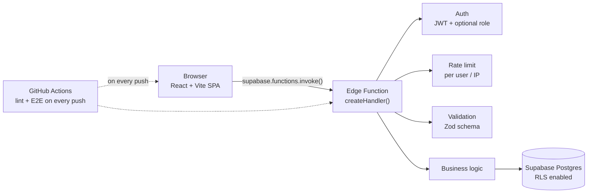

# launch-ready-boilerplate

[](https://github.com/elisafabz/launch-ready-boilerplate/actions/workflows/e2e-tests.yml)


React 19 · Vite · TypeScript · Tailwind v4 · shadcn/ui · Supabase (Edge Functions + DB)

## In plain words

Imagine you want to build a house. You could start with an empty plot and figure out the foundation, the plumbing, the electrics and the locks yourself. Or you could start with a house where all of that is already installed and checked, and you only decide on the walls, the furniture and the colours.

This repository is that ready-made foundation for a web app or an online product. It is an empty but safe starting point: the technical groundwork that every product needs, and that is easy to get wrong, is already done.

**What it gives you**
- A working project you can open on day one, instead of a week of setup.
- Safe defaults: passwords and keys are kept out of the places where they could leak, and the part that does the "real work" runs on a server, not in the visitor's browser.
- Automatic checks that catch mistakes before your product goes live, including a "ready to launch?" check that stops you from shipping placeholder text.

**Who it helps**
- Founders and product people who want to test an idea quickly, with or without a developer. It also pairs well with AI coding tools like Claude Code, because the rules are written down for them to follow.
- Anyone who builds with AI coding tools and wants guardrails from the first commit.
- Developers can use it too as a quick starting point, but it is written with beginners in mind.

**What it is not:** a finished product. It starts nearly empty on purpose. You add your idea on top.

## Why this exists

Every new product repeats the same setup, and the first version of that setup is where the expensive mistakes happen: secrets in the frontend, direct database access from the browser, missing security headers, no tests, no CI, and placeholder content that ships to production.

This starter bakes in the boring but critical parts from the first commit, so you can spend your time on the product.

- **Who it is for:** vibe coders, non-technical founders and venture builders who build with AI coding tools, and small teams shipping an MVP on React and Supabase. It is not meant to compete with the setups experienced engineers build for themselves.
- **Core assumption:** all business logic lives in Edge Functions behind authentication, never in the frontend. The browser only holds the public (publishable) key.
- **Assumes:** a Supabase project, static hosting (a `netlify.toml` is included), Node 20.19+ or 22.13+.
- **Not for:** server-side rendering, or backends other than Supabase.
- **Trade-off:** it is opinionated. You get safe defaults and a launch gate (`npm run launch-check`) in exchange for following its structure.

## A note on who made this

This starter was made by a venture builder, not a professional software engineer, together with AI coding tools. It follows widely used practices and is covered by unit tests, end-to-end tests and CI. Still, have an experienced developer review it before you handle sensitive customer data or payments.

## Architecture



Every Edge Function follows the same pipeline (preflight, auth, rate limit, validate, logic, response). The browser never sees a privileged key. See `supabase/functions/README.md`.

## Quality gates

| Gate | Command | What it enforces |
|------|---------|------------------|
| Lint | `npm run lint` | Must stay clean, CI enforces it |
| Unit tests | `npm run test` | Vitest |
| End-to-end tests | `npm run test:e2e` | Playwright against a local Supabase stack |
| Bundle budget | `npm run build` | Fails when a chunk exceeds the gzip budget |
| Security headers | `public/_headers` | CSP, HSTS and friends |
| Launch gate | `npm run launch-check` | Placeholders, favicon, social image, site URL |
| Dependency audit | weekly workflow | Known vulnerabilities in dependencies |

## Setup

```bash
npm install
npx playwright install   # REQUIRED — npm install does not fetch browser binaries
```

Without the second command every E2E test fails with
`browserType.launch: Executable doesn't exist`. This bites every fresh clone.

```bash
npm run dev          # dev server
npm run lint         # must stay clean, CI enforces it
npm run test         # unit tests (vitest)
npm run test:e2e     # end-to-end tests (playwright)
npm run build        # production build
```

## Auth and E2E login

The boilerplate ships no login UI. Auth is added per project (for an admin area use the `admin-dashboard` skill). Tests do not need a login page:

- `supabase/seed.sql` seeds `test@example.com` / `TestPassword123!` (local only, production guard).
- `tests/e2e/helpers/auth.ts` fetches a session from local GoTrue and injects it before the app loads. `getTestUserToken()` gives a bearer token for direct Edge Function calls.
- `tests/e2e/fixtures.ts` exports `test` with an `authedPage` fixture. `tests/e2e/auth.spec.ts` shows both.

Needs `VITE_SUPABASE_URL` and `VITE_SUPABASE_PUBLISHABLE_KEY` in `.env.test` (values from `supabase status`). Without them the auth tests skip.

## Before launch

```bash
npm run launch-check   # placeholders, favicon/OG image, VITE_SITE_URL
```

See `docs/LAUNCH-CHECKLIST.md` for what is enforced automatically and what each project has to fill in.

## Notes

`src/shadcn-theme.css` is vendored from the `shadcn` npm package rather than imported
from it — see the header comment in that file for why, and what to re-check after
running `npx shadcn@latest add`.

---
